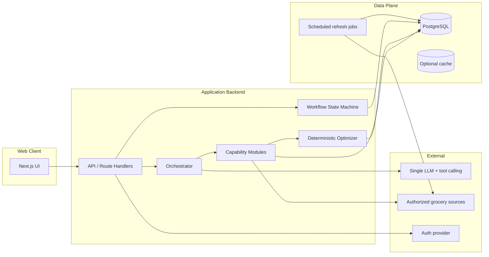

# Architecture — Agentic Grocery AI

**Status:** Draft (specification phase)  
**Related:** [adr/001-initial-stack.md](../adr/001-initial-stack.md) · [product-requirements.md](product-requirements.md) · [data-model.md](data-model.md) · [optimization.md](optimization.md)

## 1. Goals for the architecture

- Lean MVP: minimal infrastructure and API cost (NFR-002).
- One orchestrator + modular capabilities; no multi-agent swarm unless justified later.
- Deterministic code for prices, totals, constraints, savings (FR-032).
- Explicit workflow states for restock sessions.
- Clear frontend/backend boundary; secrets server-side only.

## 2. Proposed system architecture



**[ASSUMPTION]** Backend modules initially live in the same deployable (e.g., Next.js route handlers + server modules) to reduce cost; extract workers only when refresh/optimizer load requires it.

## 3. Component responsibilities

| Component | Responsibility | Must not |
| --- | --- | --- |
| Web UI | Onboarding, chat/intent, list review, approvals, consent UX | Hold API keys; invent prices |
| API layer | AuthZ, input validation, session APIs | Trust client for prices/totals |
| Orchestrator | Intent parsing via LLM, tool selection, clarification policy, explanation | Perform arithmetic for money; auto-approve |
| Workflow engine | Persist states: `draft` → `researching` → `optimizing` → `awaiting_approval` → `approved`/`rejected` | Skip approval state |
| Capability: Store discovery | Map location/postal → covered stores | Invent uncovered retailers |
| Capability: Catalog/price | Fetch & normalize authorized offers | Scrape without rights |
| Capability: Eligibility | Evaluate coupon/loyalty rules when data exists | Claim ineligible prices |
| Optimizer | Deterministic basket selection & totals | Call LLM for math |
| Jobs | Refresh catalogs/promos; mark stale | Run checkout |
| Observability | Structured logs/traces/metrics | Log secrets or raw tokens |

## 4. Request and data flows

### 4.1 Restock session (happy path)

```mermaid
sequenceDiagram
  participant U as User
  participant UI as Web UI
  participant API as API
  participant O as Orchestrator
  participant L as LLM
  participant T as Tools
  participant Opt as Optimizer
  participant DB as DB

  U->>UI: "Help me restock"
  UI->>API: Create/continue session
  API->>DB: workflow=researching
  API->>O: Handle turn
  O->>L: Understand intent + tool plan
  L-->>O: Tool calls (no final prices)
  O->>T: discover_stores / fetch_offers
  T->>DB: Persist offers + provenance
  O->>Opt: optimize(mode, constraints, offers)
  Opt-->>O: Basket + totals + baseline
  O->>DB: workflow=awaiting_approval
  O-->>UI: Draft plan + explanations
  U->>UI: Approve
  UI->>API: POST approval
  API->>DB: workflow=approved + audit
```

### 4.2 Data freshness flow

1. Scheduled job pulls authorized feeds for covered regions.
2. Each record stores `retrieved_at`, `valid_from`, `valid_to`, `source_id`.
3. At read time, freshness classifier: `fresh` | `stale` | `expired` | `unknown`.
4. UI and approval gate consume classifier output (FR-023, HITL-004).

## 5. Frontend / backend boundaries

| Concern | Frontend | Backend |
| --- | --- | --- |
| Auth session | Cookie/session UX | Verify JWT/session; enforce RLS/policies |
| Preferences | Forms | Validate & persist |
| Display totals | Render server-provided numbers | Recompute/verify on approve |
| LLM prompts | None with secrets | Server-only |
| Source credentials | Never | Vault/env/secret manager |
| Approval | Button UX | Authoritative state transition |

**Invariant:** Client-displayed basket totals are recomputed server-side on approval; mismatch → reject transition and show error.

## 6. AI orchestration design

### 6.1 Single orchestrator

- One model configured for tool calling (see ADR-001).
- Tools are typed functions with JSON schemas; each tool returns structured data + provenance.
- System prompt encodes: clarification policy, never invent prices, never claim eligibility without tool result, defer math to optimizer.

### 6.2 Modular capabilities (tools)

| Tool | Input | Output |
| --- | --- | --- |
| `get_profile` | user id | preferences, constraints |
| `resolve_location` | geo or postal | normalized area + coverage flag |
| `list_stores` | area | stores in coverage |
| `search_products` | query, constraints | product candidates |
| `fetch_offers` | store/product ids | prices/promos + provenance |
| `check_eligibility` | offer, user signals | eligible / unknown / ineligible |
| `optimize_basket` | mode, items, offers, constraints | basket, totals, savings, flags |
| `explain_plan` | optimizer result | user-facing explanation (no new numbers) |

### 6.3 Workflow states

| State | Meaning |
| --- | --- |
| `draft` | Intent captured |
| `needs_clarification` | Waiting on user |
| `researching` | Tools fetching data |
| `optimizing` | Deterministic optimize running |
| `awaiting_approval` | Plan presented |
| `approved` | User finalized |
| `rejected` | User rejected |
| `failed` | Unrecoverable; error recorded |

## 7. Error handling, retries, and observability

### 7.1 Retries

| Failure class | Strategy |
| --- | --- |
| Transient HTTP to sources | Exponential backoff, capped retries; circuit breaker per source |
| LLM timeout | Retry once; fall back to structured form UI for same step |
| Optimizer exception | Fail closed; no partial silent basket |
| Auth errors | No retry with same credentials; surface re-auth |

### 7.2 Observability (ARCH-OBS)

- Correlation id per restock session.
- Span per tool call with source id, latency, status (no payloads with secrets).
- Metrics: session success, approval rate, source error rate, stale-offer rate, optimizer duration.
- Alerts `[ESTIMATE]` on source error rate and job freshness lag once pilot runs.

## 8. Deployment and hosting approach

**Candidate (see ADR-001):** Managed hosting for web app + managed PostgreSQL (e.g., Supabase or similar) + serverless/cron for refresh jobs.

Principles:

- Single primary region in Canada if available for data residency preference `[ASSUMPTION]`.
- Environment-separated secrets (dev/stage/prod).
- No production cloud resources created during this documentation phase.

## 9. Rationale for keeping the MVP simple

| Choice | Why |
| --- | --- |
| One orchestrator | Enough for clarify → research → optimize → approve |
| Deterministic optimizer in-process | Testable, cheap, auditable |
| Co-located API + web | Fewer services, lower ops cost |
| Phased coverage | Avoid fake Canada-wide claims |
| No checkout | Removes PCI, retailer cart APIs, and liability from MVP |
| Jobs over real-time scrape | Predictable freshness; licensing-friendly if feeds exist |

**When to complicate later:** dedicated worker fleet, multi-model routing, or multi-agent debate—only if measured bottlenecks or quality gaps justify them.
