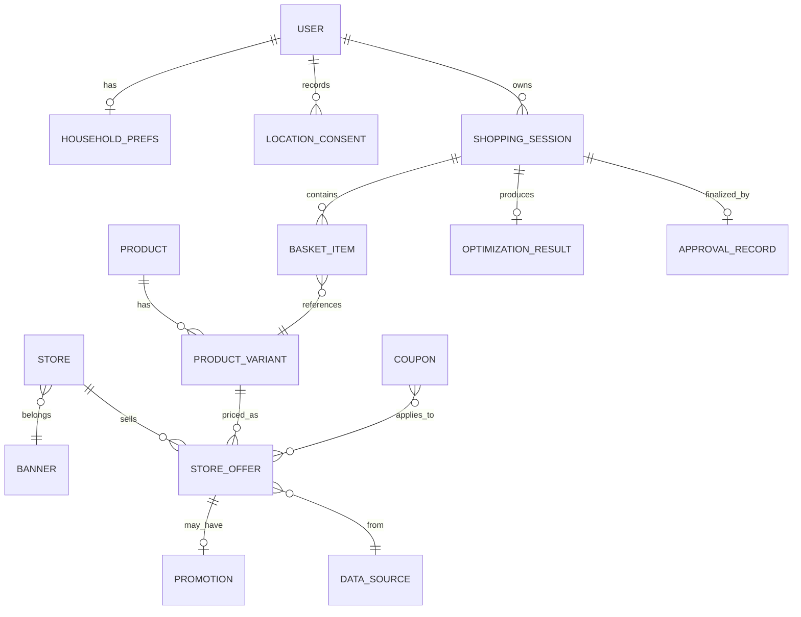

# Data Model — Agentic Grocery AI

**Status:** Draft logical model (not migrated)  
**Related:** [architecture.md](architecture.md) · [optimization.md](optimization.md) · [privacy-security.md](privacy-security.md)

IDs below are logical entities for MVP. Physical schema follows ADR-001 (PostgreSQL candidate).

## 1. Entity overview

## 2. Users and household preferences

### USER

| Column | Type | Notes |
| --- | --- | --- |
| `id` | uuid PK | |
| `auth_subject` | text unique | From auth provider |
| `email` | citext | Minimal identifier |
| `created_at` | timestamptz | |
| `deleted_at` | timestamptz nullable | Soft delete / retention |

### HOUSEHOLD_PREFS

| Column | Type | Notes |
| --- | --- | --- |
| `user_id` | uuid PK/FK | 1:1 MVP |
| `priority_mode` | enum(`budget`,`quality`,`balanced`) | FR-001 |
| `budget_cap_cents` | int nullable | Soft/hard per optimizer rules |
| `dietary_hard_constraints` | jsonb | e.g. `["peanut_free","halal"]` |
| `preferred_brands` | jsonb | |
| `excluded_brands` | jsonb | |
| `max_stores` | int nullable | |
| `max_distance_km` | numeric nullable | |
| `locale` | text | default `en-CA` |
| `updated_at` | timestamptz | |

### LOCATION_CONSENT

| Column | Type | Notes |
| --- | --- | --- |
| `id` | uuid PK | |
| `user_id` | uuid FK | |
| `method` | enum(`geo_permission`,`postal_code`,`cleared`) | |
| `postal_code` | text nullable | Store normalized; consider FSA-only retention |
| `geo_precision` | enum(`exact_unused`,`approx`,`none`) | Prefer not storing exact lat/lng long-term |
| `consented_at` | timestamptz | |
| `purpose` | text | Shown to user |

**DM-USER** links FR-003.

## 3. Stores and locations

### BANNER

| Column | Type | Notes |
| --- | --- | --- |
| `id` | uuid PK | |
| `name` | text | |
| `retailer_group` | text nullable | |
| `coverage_status` | enum(`pilot`,`ga`,`disabled`) | |

### STORE

| Column | Type | Notes |
| --- | --- | --- |
| `id` | uuid PK | |
| `banner_id` | uuid FK | |
| `external_store_id` | text | From source |
| `name` | text | |
| `postal_code` | text | |
| `latitude` / `longitude` | numeric nullable | If licensed to store |
| `province` | char(2) | |
| `active` | bool | |

**Indexes:** `(postal_code)`, `(banner_id, active)`, optional geo index if distance used.

## 4. Products and identifiers

### PRODUCT

| Column | Type | Notes |
| --- | --- | --- |
| `id` | uuid PK | |
| `canonical_name` | text | |
| `category` | text | |
| `dietary_tags` | jsonb | For constraint checks |

### PRODUCT_IDENTIFIER

| Column | Type | Notes |
| --- | --- | --- |
| `id` | uuid PK | |
| `product_id` | uuid FK | |
| `id_type` | enum(`gtin`,`sku`,`upc`,`source_native`) | |
| `value` | text | |
| `source_id` | uuid FK nullable | |

**Unique:** `(id_type, value)` where appropriate.

## 5. Product variants and package sizes

### PRODUCT_VARIANT

| Column | Type | Notes |
| --- | --- | --- |
| `id` | uuid PK | |
| `product_id` | uuid FK | |
| `brand` | text | |
| `variant_name` | text | |
| `net_quantity` | numeric | |
| `uom` | enum(`g`,`kg`,`ml`,`l`,`each`,`other`) | |
| `pack_count` | int default 1 | |
| `equivalence_key` | text nullable | Normalized key for compares |

Unit-price normalization inputs live here (OPT-UNIT).

## 6. Prices and promotions

### DATA_SOURCE

| Column | Type | Notes |
| --- | --- | --- |
| `id` | uuid PK | |
| `name` | text | |
| `class` | enum(`public_api`,`licensed_feed`,`authenticated`,`user_provided`) | |
| `licensing_status` | enum(`unverified`,`researching`,`licensed`,`rejected`) | |
| `freshness_sla_hours` | int nullable | |

### STORE_OFFER

| Column | Type | Notes |
| --- | --- | --- |
| `id` | uuid PK | |
| `store_id` | uuid FK | |
| `variant_id` | uuid FK | |
| `source_id` | uuid FK | |
| `price_cents` | int | Shelf or offer price as defined by `price_type` |
| `price_type` | enum(`shelf`,`promo`,`loyalty_gated`,`member`) | |
| `currency` | char(3) | `CAD` |
| `valid_from` / `valid_to` | timestamptz nullable | |
| `conditions` | jsonb | Textual conditions from source |
| `retrieved_at` | timestamptz | Required (FR-022) |
| `raw_ref` | text nullable | Pointer to raw blob/id—not secrets |

**DM-PRICE** / FR-022.

### PROMOTION

| Column | Type | Notes |
| --- | --- | --- |
| `id` | uuid PK | |
| `offer_id` | uuid FK | |
| `promo_type` | text | e.g. multi-buy |
| `description` | text | |
| `stackable` | enum(`yes`,`no`,`unknown`) | |

## 7. Coupons and eligibility

### COUPON

| Column | Type | Notes |
| --- | --- | --- |
| `id` | uuid PK | |
| `source_id` | uuid FK | |
| `code` | text nullable | |
| `description` | text | |
| `conditions` | jsonb | |
| `valid_from` / `valid_to` | timestamptz nullable | |
| `retrieved_at` | timestamptz | |

### ELIGIBILITY_ASSESSMENT

| Column | Type | Notes |
| --- | --- | --- |
| `id` | uuid PK | |
| `user_id` | uuid FK | |
| `coupon_or_offer_id` | uuid | |
| `status` | enum(`eligible`,`ineligible`,`unknown`) | FR-034 |
| `evidence` | jsonb | Tool result summary |
| `assessed_at` | timestamptz | |

Loyalty prices applied in optimizer **only** when `status=eligible`.

## 8. Shopping lists and basket items

### SHOPPING_SESSION

| Column | Type | Notes |
| --- | --- | --- |
| `id` | uuid PK | |
| `user_id` | uuid FK | |
| `workflow_state` | text | See architecture.md |
| `priority_mode` | enum | Snapshot at run |
| `intent_text` | text | |
| `created_at` / `updated_at` | timestamptz | |

### BASKET_ITEM

| Column | Type | Notes |
| --- | --- | --- |
| `id` | uuid PK | |
| `session_id` | uuid FK | |
| `variant_id` | uuid FK nullable | Null if gap |
| `store_id` | uuid FK nullable | |
| `offer_id` | uuid FK nullable | |
| `qty` | numeric | |
| `locked` | bool | User lock |
| `is_substitute` | bool | |
| `gap_reason` | text nullable | |
| `line_total_cents` | int nullable | From optimizer |
| `unit_price_cents` | int nullable | Normalized display helper |
| `freshness_state` | enum | |

## 9. Optimization results and approval records

### OPTIMIZATION_RESULT

| Column | Type | Notes |
| --- | --- | --- |
| `id` | uuid PK | |
| `session_id` | uuid FK | |
| `mode` | enum | |
| `basket_total_cents` | int | |
| `baseline_total_cents` | int nullable | |
| `baseline_definition` | text | Required if savings shown |
| `savings_cents` | int nullable | |
| `constraint_report` | jsonb | |
| `uncertainty_flags` | jsonb | |
| `algorithm_version` | text | For determinism audits |
| `created_at` | timestamptz | |

### APPROVAL_RECORD (DM-APPROVAL)

| Column | Type | Notes |
| --- | --- | --- |
| `id` | uuid PK | |
| `session_id` | uuid FK | |
| `action` | enum(`approve`,`reject`,`revise`) | |
| `optimization_result_id` | uuid FK | |
| `user_id` | uuid FK | |
| `ack_stale_items` | bool | HITL-004 |
| `created_at` | timestamptz | |

Finalize only when `action=approve` and server recomputed totals match.

## 10. Proposed relationships and indexes

| Index | On | Purpose |
| --- | --- | --- |
| `store_offer_lookup` | `(store_id, variant_id, retrieved_at desc)` | Latest offer |
| `offer_validity` | `(valid_to)` | Expiry jobs |
| `session_user_state` | `(user_id, workflow_state, updated_at desc)` | UX lists |
| `identifier_value` | `(id_type, value)` | Product match |
| `prefs_user` | `(user_id)` | Hot path |

## 11. Open questions

| ID | Question |
| --- | --- |
| DM-OPEN-001 | Retain exact geolocation at all, or postal/FSA only? |
| DM-OPEN-002 | Raw source payload storage duration under licenses? |
| DM-OPEN-003 | Multi-household sharing data model (post-MVP)? |
