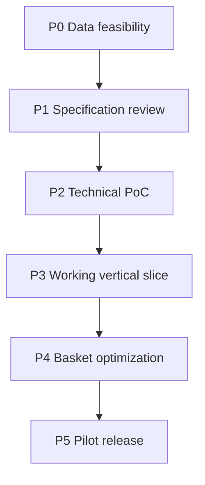

# Roadmap — Agentic Grocery AI

**Status:** Draft  
**Related:** [product-requirements.md](product-requirements.md) · [data-sources.md](data-sources.md) · [adr/001-initial-stack.md](../adr/001-initial-stack.md) · [adr/002-grocery-data-strategy.md](../adr/002-grocery-data-strategy.md)

This roadmap sequences work to an honest pilot. It does **not** estimate calendar duration.

## Phase overview

---

## P0 — Data feasibility

**Goal:** Determine whether at least one authorized Canadian grocery data path exists for a narrow pilot.

**Activities**

- Complete rows in [docs/research/data-source-matrix.md](../docs/research/data-source-matrix.md).
- Contact/partner research for APIs, licensed feeds, or flyer licensing (no scraping assumption).
- Record licensing outcomes (`unverified` → `researching` → `licensed`/`rejected`).

**Exit gate (G0)**

- [ ] ≥1 source with written path to `licensed` **or** documented blocker with fallback (manual partner CSV for one city).
- [ ] Coverage hypothesis: metro + banners listed.
- [ ] No fabricated “API exists” claims remain in matrix.

**Depends on:** External rights holders; legal review availability.

---

## P1 — Specification review

**Goal:** Lock product decisions enough to build.

**Activities**

- Review all `specs/*` and `adr/*` for consistency.
- Resolve or explicitly defer OPEN items that block PoC.
- Confirm HITL and privacy rules with stakeholders.

**Exit gate (G1)**

- [ ] Requirements FR/NFR stable; AC traceability intact.
- [ ] ADR-001 and ADR-002 accepted or revised with rationale.
- [ ] Open questions split into: resolve-now vs post-PoC.

**Depends on:** G0 sufficient to know data assumptions.

---

## P2 — Technical proof of concept

**Goal:** Prove orchestrator + one source fixture/sandbox + deterministic optimize on synthetic authorized-shaped data.

**Activities**

- Scaffold lean stack per ADR-001 (implementation starts here—not in docs phase).
- Tool-calling orchestrator with workflow states.
- Ingest sample licensed or partner fixture.
- Unit tests OPT-TC-001–004 minimum.

**Exit gate (G2)**

- [ ] End-to-end: intent → research stub → optimize → awaiting_approval on fixture data.
- [ ] Provenance fields persisted.
- [ ] No checkout code paths.
- [ ] Secrets via env only.

**Depends on:** G1; sandbox credentials if using live partner test API.

---

## P3 — Working vertical slice

**Goal:** Real web UI for onboarding, location/postal, one covered area, list review.

**Activities**

- Auth, prefs, consent recording.
- Store discovery for pilot geography.
- Draft plan UI with staleness flags.
- Approval record write.

**Exit gate (G3)**

- [ ] AC-001–006, AC-020–023, AC-040–043 demonstrable on pilot fixtures/live sandbox.
- [ ] Out-of-coverage postal codes honest empty state.

**Depends on:** G2; pilot coverage configuration.

---

## P4 — Basket optimization

**Goal:** Productionize three modes, constraints, eligibility gates, savings baselines.

**Activities**

- Full OPT-TC suite in CI (AC-070+).
- Multi-store HITL threshold.
- Eligibility assessments wired (or explicitly unknown).
- Explanation layer (LLM) consuming optimizer JSON only.

**Exit gate (G4)**

- [ ] AC-030–036 and AC-070–073 green.
- [ ] Savings never shown without baseline definition.
- [ ] Hard constraints never violated in tests.

**Depends on:** G3; clearer loyalty story or accept unknown-only for pilot.

---

## P5 — Pilot release

**Goal:** Invite-limited Canada pilot on verified coverage only.

**Activities**

- Freshness jobs + observability dashboards.
- Security checks ST-001–005.
- Privacy copy and deletion path.
- Metric collection M-001–M-007.

**Exit gate (G5)**

- [ ] G0 licensing still valid in production.
- [ ] AC-110–112 addressed.
- [ ] Runbook for source outage.
- [ ] Pilot success metrics dashboard live.

**Depends on:** G4; hosting; support process.

---

## Dependencies and release gates (summary)

| Gate | Must be true |
| --- | --- |
| G0 | Authorized data path or explicit narrow fallback |
| G1 | Specs/ADRs accepted |
| G2 | PoC e2e on fixtures |
| G3 | Vertical slice UI + approval |
| G4 | Optimizer correctness CI |
| G5 | Pilot ops + privacy/security bar |

**Cross-cutting blockers**

| Blocker | Impact |
| --- | --- |
| No licensable source | Cannot claim real deals; stop before public pilot |
| Loyalty eligibility unavailable | Ship shelf/promo only; label loyalty unknown |
| Coverage too sparse | Delay Canada-wide messaging; stay metro-scoped |

## Out of roadmap (explicit)

- Autonomous checkout.
- Multi-agent architecture.
- National coverage without per-region verification.
