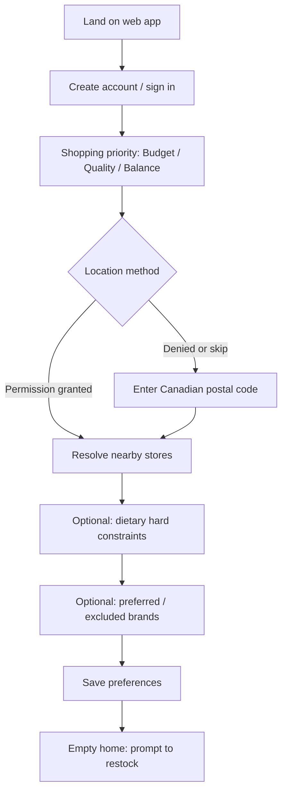
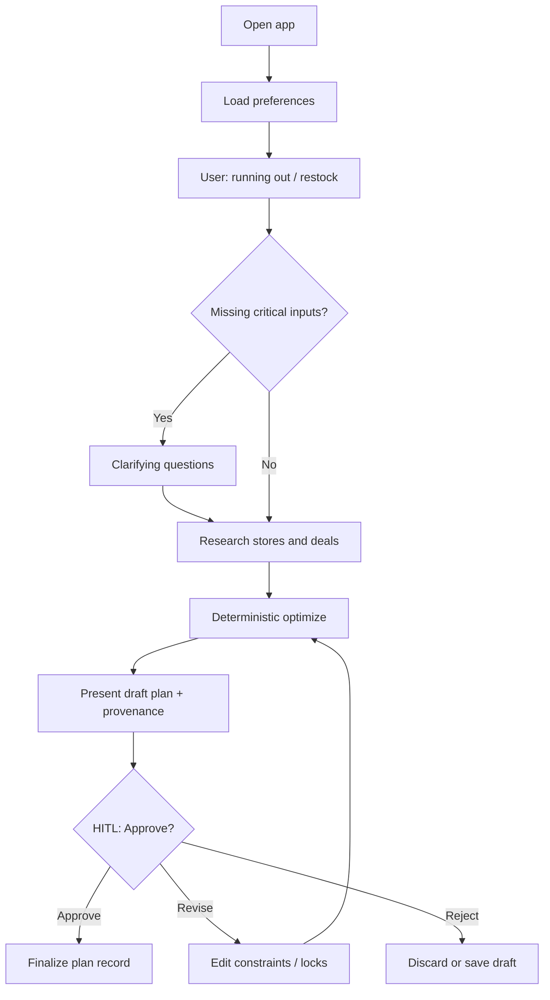
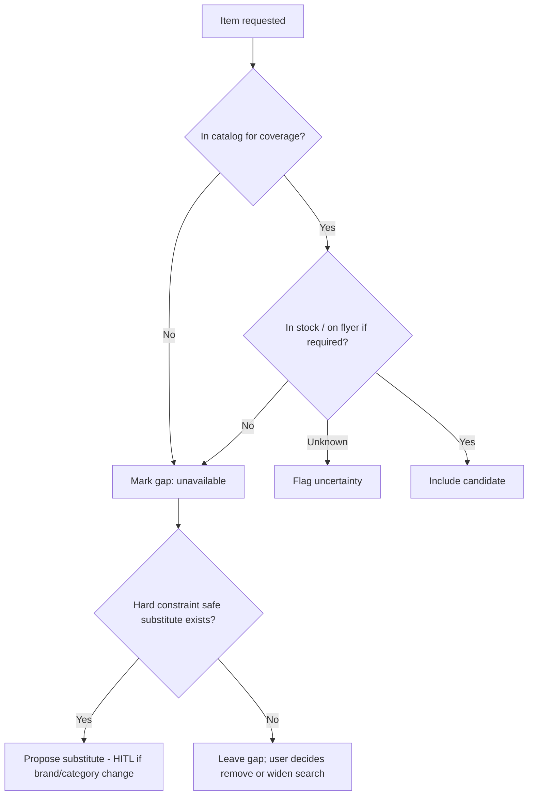

# User Journeys — Agentic Grocery AI

**Status:** Draft  
**Related:** [product-requirements.md](product-requirements.md) · [optimization.md](optimization.md) · [acceptance-criteria.md](acceptance-criteria.md)

Journeys describe happy paths and key failure paths. Decision points marked **HITL** require user input or approval.

## Journey index

| ID | Journey |
| --- | --- |
| UJ-001 | First-time onboarding |
| UJ-002 | Returning user restocking |
| UJ-003 | Budget-first shopping |
| UJ-004 | Quality-first shopping |
| UJ-005 | Balanced shopping |
| UJ-006 | Location permission and postal-code |
| UJ-007 | Missing or unavailable products |
| UJ-008 | Price verification failures |
| UJ-009 | Shopping-list review and approval |

---

## UJ-001 — First-time onboarding

**Actors:** New user  
**Requirements:** FR-001–004, PRIV-001

| Step | System behavior | User action |
| --- | --- | --- |
| 1 | Show value prop; no fabricated sample prices | Sign up / sign in |
| 2 | Require priority mode | Select mode |
| 3 | Request location with clear purpose | Allow, deny, or choose postal code |
| 4 | Show coverage honesty: only verified retailers/regions available | Acknowledge if out of coverage |
| 5 | Collect hard constraints | Enter allergies/diet rules |
| 6 | Persist profile | Continue |

**Edge cases**

- Out-of-coverage postal code → show waitlist / limited mode; do not invent stores.
- Invalid postal code → inline validation; do not proceed to store discovery.

---

## UJ-002 — Returning user restocking

**Actors:** Returning user  
**Requirements:** FR-010–012, FR-020–024, FR-030–036, FR-040–043, FR-050

**Clarification policy (UJ-CLARIFY)**

Ask only when:

- Priority unknown and not in profile.
- Location/postal code missing or coverage changed.
- Budget mode selected and no budget cap or soft target exists **and** user mentioned a budget.
- Hard constraints referenced ambiguously (“no dairy-ish”).

Do not re-ask stored brand preferences unless conflict detected.

---

## UJ-003 — Budget-first shopping

**Requirements:** FR-031, OPT-MODE-BUDGET

| Phase | Behavior |
| --- | --- |
| Goal | Minimize basket total (and/or maximize documented savings) within hard constraints |
| Store strategy | Prefer fewer stores unless multi-store savings exceed soft threshold → **HITL** ask to add store |
| Brands | Prefer cheaper equivalent SKUs; respect hard constraints and explicit brand locks |
| Coupons | Apply only if eligibility established; otherwise show as “possible if eligible” without claiming availability |
| Output | Ranked basket with unit prices, baseline, savings line, stale flags |

**HITL points:** multi-store expansion; substitutions that change category quality tier; approval.

---

## UJ-004 — Quality-first shopping

**Requirements:** FR-031, OPT-MODE-QUALITY

| Phase | Behavior |
| --- | --- |
| Goal | Maximize match to preferred brands, quality tiers, and dietary preferences; price is secondary |
| Store strategy | Prefer stores stocking preferred products; multi-store only if required for availability → **HITL** |
| Brands | Prefer locked/preferred brands; cheaper substitutes only when preferred unavailable |
| Output | Basket with quality rationale; show price delta vs cheapest equivalent as information, not as pressure |

---

## UJ-005 — Balanced shopping

**Requirements:** FR-031, OPT-MODE-BALANCED

| Phase | Behavior |
| --- | --- |
| Goal | Weighted score of unit-price savings and preference match (deterministic weights; see optimization.md) |
| Store strategy | Default single primary store; suggest second store only when net benefit clear [ASSUMPTION] |
| Output | Explain top trade-offs in plain language (LLM for explanation only; numbers from optimizer) |

---

## UJ-006 — Location permission and postal-code flows

**Requirements:** FR-002, PRIV-001

### Path A — Permission granted

1. Request geolocation with purpose string.
2. Reverse-geocode or map to service area `[ASSUMPTION]` implementation detail.
3. Persist coarse location or derived postal FSA only as needed (see privacy-security.md).
4. Load store coverage for area.

### Path B — Permission denied

1. Prompt for Canadian postal code (A1A 1A1).
2. Validate format; lookup coverage.
3. Allow change later in settings.

### Path C — Revoke / change

1. User clears location; stores list invalidated.
2. Require new postal code or permission before research.

**Must not:** silently use IP geolocation as a substitute for consent without disclosure `[ASSUMPTION]` MVP will not use IP geo unless explicitly approved later.

---

## UJ-007 — Missing or unavailable products

**Requirements:** FR-052, FR-035

Rules:

- Never auto-fill a substitute that violates hard constraints.
- Prefer asking over silent substitution when brand family changes (HITL-003).

---

## UJ-008 — Price verification failures

**Requirements:** FR-060–061, FR-023

Triggers:

- Source timeout / 5xx.
- Parse/schema validation failure.
- Conflicting prices from two authorized sources beyond tolerance `[OPEN]` tolerance TBD.
- Past `valid_to` without refresh.

Behavior:

1. Do not show failed price as confirmed.
2. Keep workflow state; retry with backoff for transient errors.
3. Offer: retry, exclude item, switch store, or proceed with remaining items (stale/uncertain labeled).
4. If critical mass of items fail, block approval until user acknowledges degraded plan.

---

## UJ-009 — Shopping-list review and approval

**Requirements:** FR-040–043, FR-050–051, HITL-001

Review screen MUST show:

- Per-line: product, variant/size, store, qty, unit price, line total, provenance, freshness state.
- Basket total and savings vs baseline (if computable).
- Constraint satisfaction summary.
- List of HITL acknowledgments still outstanding (e.g., stale items).

Actions:

| Action | Result |
| --- | --- |
| Approve | Persist finalized plan; status=`approved`; no checkout |
| Revise | Return to edit/optimize loop |
| Reject | Status=`rejected`; optional feedback |

Post-approval MVP: view/print/export list only—no purchase execution.
